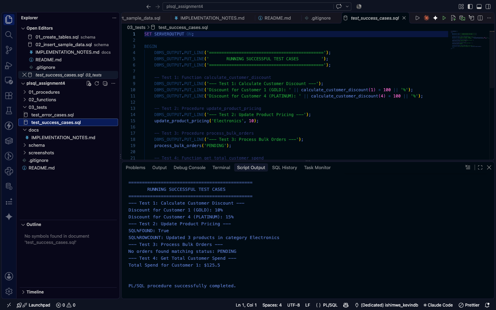
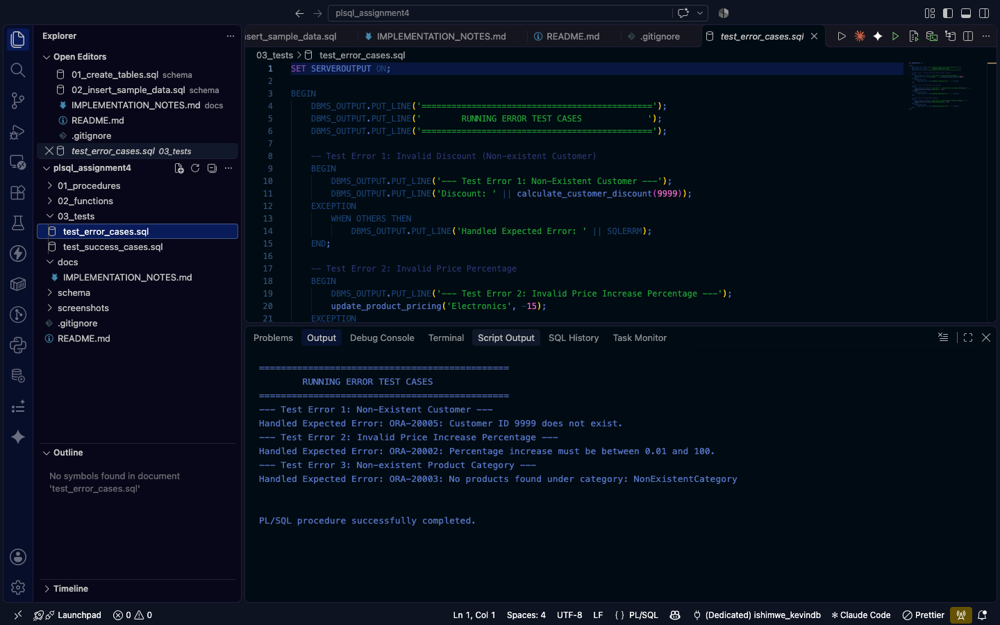

# E-Commerce & Order Processing System (Oracle PL/SQL)

**Course:** Database Development with PL/SQL (INSY 8311)  
**Instructor:** Eric Maniraguha | **TA:** Afanyu Emmanuel  
**Institution:** Adventist University of Central Africa (AUCA)  

## Group Members
* **Member 1:** Ishimwe Kevin (ID: 330601200084 / 20251SEN190)
* **Member 2:** [Partner Name] (ID: [Partner Student ID])

---

## Scenario Description
This system models an E-Commerce backend managing Customers, Products, Orders, and Order Items. It demonstrates key Oracle PL/SQL concepts:
* **User-Defined & %ROWTYPE Records**
* **Collections** (Nested Tables & Associative Arrays)
* **Implicit Cursors & Attributes** (`SQL%ROWCOUNT`, `SQL%FOUND`, `SQL%NOTFOUND`)
* **Explicit Cursors**
* **Bulk Processing** (`BULK COLLECT`, `FORALL`, `SAVE EXCEPTIONS`)
* **Stored Procedures & Stored Functions**
* **Robust Exception Handling** (Predefined, User-Defined, `RAISE_APPLICATION_ERROR`)
* # E-Commerce & Order Processing System (Oracle PL/SQL)

**Course:** Database Development with PL/SQL (INSY 8311)  
**Instructor:** Eric Maniraguha | **TA:** Afanyu Emmanuel  
**Institution:** Adventist University of Central Africa (AUCA)  

## Group Members
* **Member 1:** Ishimwe Kevin (ID: 20251SEN190)
* **Member 2:** Ishimwe Kevin (ID: 20251SEN015)

---

## Scenario Description
This system models an E-Commerce backend managing Customers, Products, Orders, and Order Items. It demonstrates key Oracle PL/SQL concepts:
* **User-Defined & %ROWTYPE Records**
* **Collections** (Nested Tables & Associative Arrays)
* **Implicit Cursors & Attributes** (`SQL%ROWCOUNT`, `SQL%FOUND`, `SQL%NOTFOUND`)
* **Explicit Cursors**
* **Bulk Processing** (`BULK COLLECT`, `FORALL`, `SAVE EXCEPTIONS`)
* **Stored Procedures & Stored Functions**
* **Robust Exception Handling** (Predefined, User-Defined, `RAISE_APPLICATION_ERROR`)

* ## 📸 Execution Screenshots

### Success Test Cases Output


---

### Error Handling Test Cases Output


---

## AI Disclosure
An AI assistant was utilized to assist with structuring code templates, generating sample dataset INSERT statements, and formatting documentation. Both group members independently reviewed, tested, compiled, and verified all PL/SQL blocks and understand all logic.

---

## How to Run

1. **Create Tables & Constraints:**
   ```sql
   @00_schema/01_create_tables.sql

---

## AI Disclosure
An AI assistant was utilized to assist with structuring code templates, generating sample dataset INSERT statements, and formatting documentation. Both group members independently reviewed, tested, compiled, and verified all PL/SQL blocks and understand all logic.

---

## How to Run

1. **Create Tables & Constraints:**
   ```sql
   @00_schema/01_create_tables.sql
